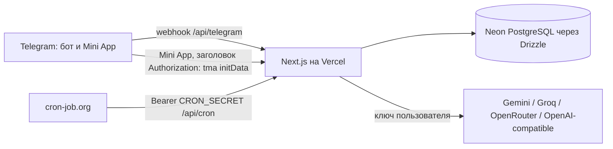

# Stumpy LifeOS

Личный LifeOS в Telegram: питание только по КБЖУ, деньги и тренировки. Бот принимает обычные сообщения, Mini App даёт полный ручной ввод и обзор дня, а ИИ (ваши собственные ключи) лишь ускоряет ввод.


> Проект в бете: код трёх модулей написан, но сквозная проверка на реальных сервисах и устройствах не завершена. Подробности — в разделе [Статус и дорожная карта](#статус-и-дорожная-карта).

## Оглавление

- [Возможности](#возможности)
- [Как это работает](#как-это-работает)
- [Быстрый старт](#быстрый-старт)
- [Команды](#команды)
- [Структура репозитория](#структура-репозитория)
- [Развёртывание](#развёртывание)
- [Безопасность и приватность](#безопасность-и-приватность)
- [Документация](#документация)
- [Статус и дорожная карта](#статус-и-дорожная-карта)
- [Вклад](#вклад)
- [Лицензия](#лицензия)

## Возможности

Приложение рассчитано на нескольких пользователей Telegram: у каждого свой профиль, определяемый проверенным Telegram ID. Mini App полностью работает без ИИ; чат-бот автоматизирует тот же ввод.

### Питание

- Только КБЖУ: без выбора приёма пищи и без взвешивания еды.
- Запись текстом или фото еды/этикетки; еда сохраняется после «Записать», исправление — следующим сообщением.
- Несколько приёмов пищи в сообщении подтверждаются отдельно.
- Цели, сохранённые блюда, масса тела, календарь истории по дням.

### Финансы

- Расходы, доходы, категории, счета в любых валютах (код из 3-5 латинских букв, например `PRB` для рублей ПМР).
- Основная валюта — валюта первого счёта; курс остальных вводится вручную, каждая операция хранит курс на момент записи.
- Регулярные платежи (подписка становится расходом только после подтверждения списания), отчёты, планы покупок, долги в обе стороны с частичными возвратами.
- Фото кассового чека разбирается по позициям: каждая становится отдельным расходом.
- Расход и еда из одного сообщения — всегда отдельные черновики со своими «Записать», «Исправить», «Отменить».

### Зал

- Собственная программа и журнал подходов в Mini App; пользователь выбирает упражнения сам.
- Каталог встроенных упражнений, ручные упражнения, поиск, замена, сортировка, кардио-поля, история, таймер отдыха, подсказка о возможном повышении веса.

### ИИ-провайдеры (BYOK)

- Каталог: Gemini, Groq, OpenRouter и дополнительный HTTPS OpenAI-compatible endpoint; Cerebras в каталоге есть, но заблокирован, так как его пробный доступ требует платёжный метод.
- Каждый пользователь подключает свои ключи, выбирает бесплатные модели и общий порядок fallback.
- Gemini требует явного подтверждения Free Tier: по API-ключу биллинг проекта не определить.
- Мастер первой настройки в Mini App, затем настройки открываются шестерёнкой.

### Прочее

- Персонализация: разделы, функции и сводки включаются по желанию.
- Ежедневные и еженедельные сводки, напоминания по просроченным долгам (через cron-маршрут).
- Экспорт и восстановление данных в JSON.

## Как это работает



- Один Next.js-проект (App Router): Mini App, API-маршруты и доменная логика; отдельного бэкенда нет.
- Webhook проверяет секретный заголовок Telegram, сохраняет update и отвечает; обработка продолжается через Next.js `after()` в пределах времени функции. Это не долговечная очередь.
- Cron-маршрут повторяет зависшие или неудачные события и отправляет сводки и напоминания.
- Mini App проверяет подпись и срок `initData`; данные выбираются по проверенному Telegram ID.
- Арифметика выполняется кодом; структура ответов ИИ проверяется Zod.
- Изображения не сохраняются в собственном постоянном хранилище: они передаются выбранному ИИ-провайдеру на время разбора.

Подробнее — [docs/architecture.md](docs/architecture.md).

## Быстрый старт

### Требования

- Node.js 22 или новее и npm.
- PostgreSQL-база (в проекте используется Neon Serverless).
- Telegram-бот (токен от BotFather).
- Публичный HTTPS-адрес для webhook и Mini App (для регистрации webhook).

### Установка

```bash
npm ci
cp .env.example .env
```

### Переменные окружения

Значения секретов храните только локально и в настройках хостинга; в репозиторий они не попадают.

| Переменная | Обязательная | Назначение |
|---|---|---|
| `DATABASE_URL` | да | Строка подключения к PostgreSQL |
| `TELEGRAM_BOT_TOKEN` | да | Токен бота |
| `TELEGRAM_WEBHOOK_SECRET` | да, для webhook | Секрет, который Telegram присылает в заголовке `x-telegram-bot-api-secret-token` |
| `AI_PROVIDER_ENCRYPTION_KEY` | да, для ИИ-ключей пользователей | Ключ шифрования AES-256-GCM: `openssl rand -base64 32` |
| `CRON_SECRET` | да, для cron | Защита маршрута `/api/cron` (`Authorization: Bearer ...`) |
| `APP_URL` | нет, нужна скрипту регистрации webhook | Публичный HTTPS-адрес приложения |
| `TELEGRAM_OWNER_ID` | нет | Telegram ID владельца: метрики Gemini и CLI-резервирование |
| `DAILY_SUMMARY_TIME` | нет | Время ежедневной сводки, по умолчанию `19:30` |
| `WEEKLY_SUMMARY_TIME` | нет | Время еженедельной сводки, по умолчанию `19:30` |
| `GOOGLE_CLOUD_SERVICE_ACCOUNT_JSON`, `GOOGLE_CLOUD_PROJECT_ID`, `GEMINI_MODEL` | нет | Только метрики квоты Gemini для владельца |

Без `DATABASE_URL` и `TELEGRAM_BOT_TOKEN` приложение показывает экран настройки. Ключи ИИ из окружения не используются: их вводит каждый пользователь в Mini App. Потеря `AI_PROVIDER_ENCRYPTION_KEY` сделает сохранённые ключи нечитаемыми.

### Миграции

```bash
npm run db:migrate
```

### Запуск

```bash
npm run dev
```

### Регистрация webhook

Нужны заполненные `TELEGRAM_BOT_TOKEN`, `TELEGRAM_WEBHOOK_SECRET` и HTTPS `APP_URL`:

```bash
npm run telegram:register
```

Скрипт регистрирует `<APP_URL>/api/telegram` и принимает updates типов `message` и `callback_query`.

## Команды

| Команда | Что делает |
|---|---|
| `npm run dev` | Dev-сервер Next.js |
| `npm run build` | Production-сборка |
| `npm run start` | Запуск собранного приложения |
| `npm run lint` | ESLint |
| `npm run typecheck` | Проверка типов (`tsc --noEmit`) |
| `npm test` | Тесты на `node --test` (`tests/*.test.ts`) |
| `npm run db:generate` | Генерация SQL-миграции из `src/db/schema.ts` |
| `npm run db:migrate` | Применение миграций из `drizzle/` |
| `npm run telegram:register` | Регистрация Telegram webhook |
| `npm run backup:export -- ./backup.json` | Экспорт профиля в JSON |
| `npm run backup:restore -- ./backup.json` | Восстановление в пустой профиль |

CLI-резервирование требует `TELEGRAM_OWNER_ID` нужного профиля. Восстановление работает только в пустой профиль с совпадающим Telegram ID и не перезаписывает данные. Авторизованный пользователь может получить копию через `GET /api/export`. BYOK-ключи в резервные копии не входят.

## Структура репозитория

```text
src/
  app/            Next.js App Router: страница Mini App, layout, глобальные стили
    api/          Маршруты: telegram, commands, snapshot, cron, export,
                  ai-providers, ai-quotas
  components/     Интерфейс Mini App: finance, onboarding, settings, ai-providers,
                  ai-quotas, reports, editor, glass, motion, loading, lifeos
  domain/         Бизнес-правила без зависимостей от транспорта: питание, валюты,
                  планы, долги, прогрессия, команды, каталог упражнений
  server/         Серверная логика: ai (провайдеры, очередь моделей, разбор),
                  telegram, резервные копии, HTTP-утилиты, доступ к данным
  db/             Схема Drizzle и клиент Neon
drizzle/          SQL-миграции (0000-0013) и метаданные
scripts/          Регистрация webhook, резервное копирование, загрузка окружения
tests/            Тесты на node --test
docs/             Продукт, архитектура, план, исследования, аудиты, визуальный эталон
```

## Развёртывание

Целевая схема: Vercel + Neon + cron-job.org. Бесплатный запуск в пределах квот; автоматические платные расходы не допускаются.

1. Создайте базу Neon и задайте `DATABASE_URL`; примените `npm run db:migrate`.
2. Подключите репозиторий к Vercel и задайте переменные окружения из таблицы выше.
3. Выпускайте изменения через ветку, PR и Vercel Preview, затем слияние в `main` (правила — в [CLAUDE.md](CLAUDE.md) и [AGENTS.md](AGENTS.md)). Preview не получает Telegram- и Neon-переменных, поэтому Mini App API там без них не проверить.
4. Зарегистрируйте webhook командой `npm run telegram:register` с production `APP_URL`.
5. Настройте cron-job.org на регулярный вызов `<APP_URL>/api/cron` с заголовком `Authorization: Bearer <CRON_SECRET>`.
6. Укажите URL Mini App в BotFather.

## Безопасность и приватность

Только то, что подтверждается кодом:

- Mini App проверяет подпись и срок Telegram `initData`; профиль определяется проверенным Telegram ID, данные модулей и ИИ-провайдеров привязаны к профилю.
- Webhook принимает только запросы с верным `x-telegram-bot-api-secret-token`; cron-маршрут — только с `Authorization: Bearer <CRON_SECRET>`. Сравнение выполняется за постоянное время.
- API-ключи пользователей шифруются AES-256-GCM серверным `AI_PROVIDER_ENCRYPTION_KEY` и не возвращаются клиенту.
- Ключи ИИ из окружения сервера не используются: только введённые пользователями.
- Фото уходят выбранному ИИ-провайдеру на время разбора и не сохраняются в базе LifeOS; хранение у провайдера LifeOS не контролирует.
- BYOK-ключи не входят в резервные копии.
- Изоляция по второму реальному Telegram-аккаунту ещё не проверена на production.

## Документация

| Документ | Что в нём |
|---|---|
| [docs/product.md](docs/product.md) | Бизнес-сценарии и границы продукта |
| [docs/architecture.md](docs/architecture.md) | Стек, схема, API, переменные, ограничения |
| [DESIGN.md](DESIGN.md) | Направление Liquid Glass и состояние интерфейса |
| [docs/reference/README.md](docs/reference/README.md) | Утверждённый визуальный эталон |
| [docs/implementation-plan.md](docs/implementation-plan.md) | Что сделано и что осталось до первой версии |
| [CHANGELOG.md](CHANGELOG.md) | Изменения по выпускам |
| [docs/research.md](docs/research.md) | Исследование открытых решений и лицензий |
| [docs/release-plan.md](docs/release-plan.md) | План до релиз-кандидата: блокеры, этапы, решения владельца |
| [docs/audit/](docs/audit/) | Аудиты: код, архитектура и SOLID, безопасность, документация, готовность к релизу |
| [docs/ux-audit/](docs/ux-audit/README.md) | UX-аудит по модулям и план исправлений |
| [docs/audit-2026-11-12.md](docs/audit-2026-11-12.md), [docs/unslop-audit.md](docs/unslop-audit.md) | Предыдущие аудиты |
| [AGENTS.md](AGENTS.md) | Правила работы с кодом и проектом |

Визуальный эталон (исторический макет, не само приложение):


## Статус и дорожная карта

Версия `0.22.0`, бета; `1.0.0` выйдет после закрытия критериев первой полезной версии из [плана реализации](docs/implementation-plan.md). Изменения по выпускам — в [CHANGELOG.md](CHANGELOG.md).

| Что | Состояние |
|---|---|
| Три модуля (питание, финансы, зал) | Реализованы в коде |
| Production: Vercel, Neon, Telegram webhook | Подключены, webhook обрабатывал production updates |
| Миграции в production | Применены `0000`-`0013` (мультивалютность и `message_id` черновиков накатаны отдельно); часть документов ещё указывает `0000`-`0011` и обновляется |
| cron-job.org | Тестовый вызов `/api/cron` вернул `200 OK`; доставка сводок не подтверждена |
| Разбор ИИ, подключение ключей BYOK, квоты | Требуют сквозной проверки на реальных сервисах |
| Долги, мультивалютность, планы покупок | Требуют проверки на личных данных |
| Telegram WebView, fullscreen, safe area | Требуют проверки на реальных устройствах |
| Изоляция профилей | Нужна проверка вторым Telegram-аккаунтом |
| Экспорт и восстановление | Нужна проверка на реальных данных |

## Вклад

Проект ведёт один человек; перед большой работой откройте issue. Подробные правила, формат `CHANGELOG.md` и условия лицензии вклада описаны в [CONTRIBUTING.md](CONTRIBUTING.md). О проблемах безопасности сообщайте приватно по инструкции из [SECURITY.md](SECURITY.md).

Контакты автора: [@only1stumpy](https://github.com/only1stumpy), penbeatmaker@gmail.com.

## Лицензия

Код открыт для чтения, запуска и изменения **для некоммерческих целей** на условиях [PolyForm Noncommercial 1.0.0](LICENSE). Автор и правообладатель: Евгений Степанов ([@only1stumpy](https://github.com/only1stumpy)). При распространении кода, в том числе изменённого, нужно сохранить текст лицензии и строку `Required Notice` из файла [LICENSE](LICENSE).

Коммерческое использование (продажа, платный сервис, использование внутри коммерческой организации) этой лицензией не разрешено; по вопросам отдельной лицензии пишите на penbeatmaker@gmail.com.

Лицензия PolyForm Noncommercial не входит в список OSI, поэтому проект правильнее называть «исходный код доступен» (source-available), а не «open source» в строгом смысле. Шрифты Medeo Sans и Medeo Mono распространяются отдельно по [SIL Open Font License 1.1](https://github.com/DNFDEVS/medeo-font) и не меняют условия лицензии проекта.
