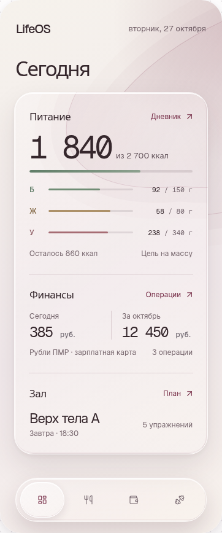

# Stumpy LifeOS

LifeOS в Telegram для нескольких пользователей: дневник питания только по КБЖУ, учёт денег и журнал тренировок. Бот принимает сообщения и фотографии, Mini App показывает обзор дня, историю и инструменты для тренировки.

**Статус на 29 октября 2026 года:** production Neon содержит миграции `0000`–`0006`; наличие долговых таблиц и новый тип черновика проверены прямым запросом. Долги поддерживают оба направления, частичные возвраты с финансовыми операциями, старые остатки без задней записи, чатовые черновики с подтверждением, Mini App и ежедневные напоминания после срока. Production-деплой Vercel для commit `64c87b6` имеет статус READY. PR #24 с онбордингом ИИ и отдельной вкладкой настроек имеет READY Preview на commit `1064f78`; production-миграция `0007` ещё не применена. Preview главная отвечает `200`, но в Preview нет Telegram/Neon-переменных, поэтому Mini App API и сквозной сценарий там пока не проверены. Остальные критерии перечислены в [плане реализации](docs/implementation-plan.md).

## Документация

| Документ | Что в нём |
|---|---|
| [Продуктовые требования](docs/product.md) | Согласованные сценарии и статус их реализации |
| [Архитектура](docs/architecture.md) | Фактические зависимости, схема, API, переменные и ограничения |
| [DESIGN.md](DESIGN.md) | Утверждённое направление Liquid Glass и текущее состояние интерфейса |
| [План реализации](docs/implementation-plan.md) | Выполненные части и недостающие критерии первой версии |
| [Исследование решений](docs/research.md) | GitHub-референсы, применимость, лицензии и первичные источники |
| [AGENTS.md](AGENTS.md) | Правила работы с кодом и требования проекта |
| [Визуальный эталон](docs/reference/README.md) | Утверждённый макет и границы его применимости |

## Первая полезная версия

Все три модуля первой версии реализованы в коде. Базовая связка Telegram → Vercel → Neon подтверждена обработкой production updates; проверка реальных сценариев и завершённый личный запуск ещё впереди.

- **Питание:** только КБЖУ, текст или фото еды/этикетки, бытовые порции, отдельное подтверждение каждой записи, цели, сохранённые блюда и масса тела. Долгая история открывается календарём по месяцам с КБЖУ выбранного дня.
- **Финансы:** расходы, доходы, категории, счета PRB (рубли ПМР) и USD, ручные курсы с историческим снимком для каждой операции, регулярные платежи, отчёты, планы будущих покупок и долги. План содержит только название и цену в PRB и создаётся в Mini App или сообщением `план <название> <сумма>`; покупка подтверждается как расход и закрывает план. Долг хранит человека, направление, сумму, необязательные срок и заметку; возвраты можно записывать частями, а каждый подтверждённый возврат создаёт финансовую операцию. Старый долг добавляется без операции задним числом. Бот ежедневно напоминает об открытых долгах после даты срока. Миграция `0006` применена, код долгов выкачен в production; сами сценарии создания и возврата нужно проверить на личных данных. Баланс основного счёта — главный показатель на главном экране и во вкладке «Финансы»; траты за день и месяц показаны ниже. Обычная финансовая операция в чате сохраняется только после «Записать».
- **Зал:** собственная программа и журнал подходов в Mini App, каталог из 25 встроенных упражнений с краткими подсказками по технике, ручные упражнения, поиск, замена и сортировка, кардио-поля, история, таймер отдыха и подсказка о возможном повышении веса после выполненных подходов.

Приложение доступно пользователям Telegram; каждый получает отдельный профиль по своему Telegram ID. Данные питания, финансов, тренировок и API-провайдеров изолированы по профилю. `/start` объясняет подключение ИИ; при первом открытии Mini App автоматически начинается настройка. Компактный список провайдеров ведёт на отдельные экраны подключения, выбора моделей и общей очереди моделей. Очередь определяет порядок fallback между моделями, а аккаунты с одной моделью остаются резервами друг друга. Cerebras заблокирован из-за требования платёжного метода, Gemini требует подтверждения Free Tier; также есть расширенный OpenAI-compatible endpoint без проверки стоимости.

## Локальный запуск

Нужен Node.js 22 или новее и npm. Команды сверены с `package.json`.

```bash
npm ci
cp .env.example .env
npm run dev
```

Без настроенных `DATABASE_URL` и `TELEGRAM_BOT_TOKEN` приложение показывает экран настройки. `TELEGRAM_OWNER_ID` необязателен: он сохраняет доступ владельца к старым deployment-wide ключам и метрикам Gemini. Для рабочих данных потребуются база, bot token и миграции на принадлежащей пользователю PostgreSQL-базе:

```bash
npm run db:migrate
```

Добавьте `TELEGRAM_WEBHOOK_SECRET` для Telegram webhook и `CRON_SECRET` для защищённых сводок. Для пользовательских API-ключей сгенерируйте `AI_PROVIDER_ENCRYPTION_KEY` командой `openssl rand -base64 32` и сохраните его как секрет сервера. Подключение проверяет ключ и доступные модели коротким запросом до сохранения; проверка расходует запрос из квоты. Новые модели автоматически включаются и добавляются в конец общей очереди; пользователь может изменить выбор и порядок. Миграция `0007_ai_setup_onboarding.sql` добавляет флаги первичной настройки и инициализации очереди моделей. OpenRouter показывает только модели `:free` с нулевой ценой из каталога. В Gemini требуется подтвердить Free Tier: LifeOS не может проверить биллинг проекта по API-ключу. Расширенный OpenAI-compatible endpoint принимает пользовательские endpoint, модель и ключ; стоимость не проверяется. Ключи шифруются AES-256-GCM и не возвращаются клиенту. Для локальной проверки можно отдельно задать legacy `GEMINI_API_KEY` и `GROQ_API_KEY`; они используются только для аккаунта, совпадающего с `TELEGRAM_OWNER_ID`. `APP_URL` нужен скрипту регистрации webhook. Секреты не помещайте в репозиторий и не отправляйте в чат. Потеря `AI_PROVIDER_ENCRYPTION_KEY` сделает сохранённые пользовательские ключи нечитаемыми; перед ротацией нужна отдельная процедура перешифрования.

Если разбор не удался, сообщение бота пояснит причину: лимит запросов, недоступность API или проблему с ключом/правами/моделью. Об исчерпанных оплаченных кредитах оно говорит только когда провайдер явно сообщает об этом; ограничение `429` само по себе может быть лимитом частоты или квоты. Если настроены оба провайдера, сообщение перечислит причину отказа каждого. Неудачная попытка ничего не записывает — данные можно внести вручную.

Настройки ИИ открываются значком шестерёнки в нижней навигации; после первичной настройки там доступны профили, модели и единая очередь. Скрытая вкладка лимитов показывает опубликованную квоту OpenRouter `:free` и счётчик обращений LifeOS по каждому аккаунту/модели за 24 часа. У Groq значения лимитов зависят от организации: документация публикует базовые значения Developer tier, поэтому LifeOS не выдаёт их за бесплатную квоту и показывает только свой счётчик. Ни один такой счётчик не является остатком ключа: чужие вызовы тем же ключом панель не видит. Метрики Gemini из Google Cloud Monitoring отображаются дополнительно только legacy-аккаунту с настроенными credentials.

Проверки и подготовка webhook:

```bash
npm run lint
npm run typecheck
npm test
npm run build
npm run telegram:register
```

`telegram:register` вызывает Telegram Bot API и требует заполненных `TELEGRAM_BOT_TOKEN`, `TELEGRAM_WEBHOOK_SECRET` и HTTPS `APP_URL`. Команды миграции требуют `DATABASE_URL`; CLI-экспорт/восстановление требуют ID соответствующего Telegram-профиля в `TELEGRAM_OWNER_ID`.

Для JSON-резервной копии и восстановления используйте:

```bash
npm run backup:export -- ./lifeos-backup.json
npm run backup:restore -- ./lifeos-backup.json
```

Восстановление предусмотрено только в пустой профиль с совпадающим Telegram ID; оно не перезаписывает существующие данные. Серверный `GET /api/export` отдаёт резервную копию авторизованному пользователю. BYOK-ключи в резервные копии не входят.

## Принятая техническая основа

В коде закреплены Next.js App Router, TypeScript, grammY webhook, Neon Serverless PostgreSQL, Drizzle, Zod и Vercel-совместимые Node.js маршруты. Production Vercel, Neon и Telegram webhook подключены; фактический статус и оставшиеся настройки — в [архитектуре](docs/architecture.md). Точные версии находятся в `package.json`; Node.js `>=22`.

Legacy `GEMINI_API_KEY` и cron-job.org настроены в Production; тестовый запрос к cron-маршруту прошёл с `200 OK`. Реальный разбор ИИ и доставка сводок пока не подтверждены. Каталог провайдеров уже выкачен, а новый сценарий первой настройки и миграция `0007` требуют выкладки. Принадлежность Gemini-проекта к бесплатному тарифу подтверждается пользователем и не считывается приложением.

## Дизайн

Светлый Liquid Glass, многослойные фоновые градиенты, прозрачные поверхности с локальными бликами и кромками, бордовый акцент, Medeo Sans и Mono, крупные показатели и пять иконок навигации без эмодзи. Настройки ИИ находятся на отдельном экране и открываются шестерёнкой; название LifeOS в шапке остаётся статичным. Приложение использует fallback для браузеров без SVG-преломления; Telegram WebView ещё требует отдельной проверки.


