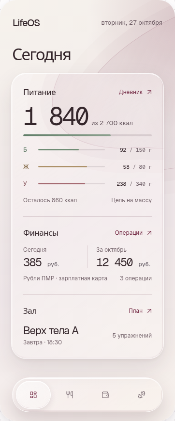

# Утверждённый визуальный эталон

27 октября 2026 года пользователь утвердил вторую концепцию: прозрачный Liquid Glass и Medeo. Первый карточный вариант не является эталоном.

- [Снимок главного экрана](lifeos-clear-medeo.png) фиксирует согласованную композицию.
- [Исходный HTML-фрагмент](lifeos-clear-medeo.fragment.html) сохраняет интерактивную концепцию без изменений. Это фрагмент для среды визуализаций Codex, не самостоятельное Next.js-приложение; открытие как обычной HTML-страницы не гарантирует работу окружения.
- [DESIGN.md](../../DESIGN.md) описывает требования для переноса в приложение.

Исходный файл назывался `lifeos-clear-medeo.html`. Архивная копия побайтово сохранена из визуализации текущего обсуждения; абсолютные пути машины не требуются будущему разработчику.

Данные и взаимодействия демонстрационные. Прототип не подключён к Telegram, ИИ или базе, не реализует авторизацию и не сохраняет серверные данные. Поле граммов показывает перерасчёт и не обязывает пользователя взвешивать еду. Цель калорий, суммы, даты и упражнения не являются настройками владельца.

Шрифты загружаются из CDN с закреплённой ревизией Medeo, поэтому их показ требует сети. Уведомление об источнике и OFL сохранено в HTML; права на шрифты и условия их поставки описаны в DESIGN.md. Файлы шрифтов в этот каталог не включены.
